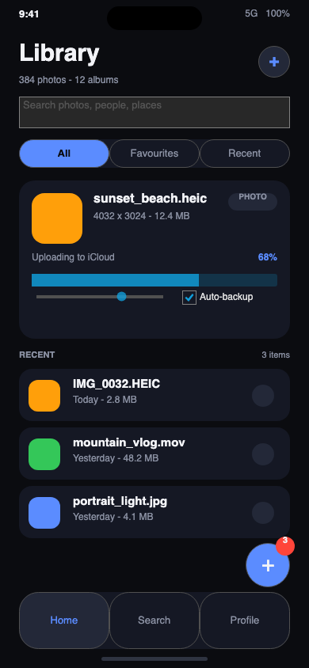

# SwimUI

**SwimUI** is [Swim](docs/swim.md) — a Swift-syntax language that compiles to
Nim — with a **FerroUI** native module: a binding of the
[FerroUI](https://github.com/wieslawsoltes/FerroUI) cross-platform UI framework,
so a complete application can be written in Sw**i**ft-looking Sw**im** and drawn
by a real, themed, retained-mode control library.

```swift
import SwimUI

setThemeVariant("dark")

runApp {
    let screen = Screen(width: 390, height: 844, title: "Library",
                        background: 0x0B0C10, borderless: true)
    screen.onReady {
        screen.label(x: 24, y: 54, width: 260, height: 42, text: "Library",
                     size: 30, bold: true)
        screen.button(x: 326, y: 58, width: 40, height: 40, title: "+",
                      fill: 0x232838, titleColor: 0x5B8CFF, radius: 20,
                      size: 22, bold: true) {
            printLog("Album created")
        }
    }
}
```

```console
$ ./scripts/build-ffi.sh      # build the FerroUI bridge (once)
$ ./scripts/run-demo.sh       # build and run the demo below
```



The demo (`ui/FerroUIDemo.sw`, 390 × 844 points, a borderless phone-sized
window) is interactive: the segmented control swaps the hero file, the slider
moves the upload percent, the check box switches the backup mode, tapping a row
selects it, the two `+` buttons change the album and photo counts, the tab bar
switches tabs and a toast reports what happened.

---

## Table of contents

- [What SwimUI is](#what-swimui-is)
- [Quick start](#quick-start)
- [How it works](#how-it-works)
- [The Swift-style view layer](#the-swift-style-view-layer)
- [The `FerroUI` native module](#the-ferroui-native-module)
- [Project layout](#project-layout)
- [Tests](#tests)
- [Swim, the language](#swim-the-language)
- [Differences from Swift / limitations](#differences-from-swift--limitations)
- [License](#license)

---

## What SwimUI is

Two existing projects, one binding:

| Layer | Project | What it brings |
| --- | --- | --- |
| Language | [Swim](docs/swim.md) | Swift syntax, compiled to readable Nim, ARC, modules, a full standard library |
| UI | [FerroUI](https://github.com/wieslawsoltes/FerroUI) | A retained-mode UI framework in Rust: properties, styling, themes, layout, text, native windows |
| Binding | **SwimUI** (this repository) | `import FerroUI` in a `.sw` file, the `SwimUI.sw` view layer over it, and the demo |

Swim's design goal is that a `.sw` file never mentions Nim or Rust: the native
implementation stays behind a small, flat, Swift-friendly surface of `Int`
handles, numbers, strings, booleans and `() -> Void` closures.  SwimUI keeps
that rule for FerroUI:

```
  ui/FerroUIDemo.sw            a program in Swift syntax
        │
  src/swimc/                   the Swim compiler: lexer, parser, types, codegen
        │  emits
  <program>.nim                Nim, with `import swimrt` and `import swimferroui`
        │  links with
  runtime/swimferroui.nim      the Nim side of the binding: Int handles, colors,
        │                      closures; declares the C ABI of the bridge
        │  calls through
  ffi/ (Rust)                  `ferroui-swim`: a cdylib that hosts the FerroUI
        │                      application and maps handles to controls
        │  builds
  FerroUI (Rust)               windows, controls, themes, the compositor
```

The bridge is built once (`scripts/build-ffi.sh`) into `build/`, and every
program that writes `import FerroUI` loads it at run time.  Nim is still the
only execution backend — the binding is a native module of the Swim runtime, the
same way `import Nimx` binds the nimx toolkit (see
[`projects-main/`](projects-main/) for that older demo).

## Quick start

Requirements: **Nim** 2.x, **Python 3**, a **Rust** toolchain (cargo), and a
checkout of **FerroUI** next to this one (`../FerroUI`; set `FERROUI_DIR` to
use another one).

```console
$ ./scripts/build-ffi.sh                # build the Rust bridge into build/
$ ./scripts/run-demo.sh                 # build and run ui/FerroUIDemo.sw
```

The first `build-ffi.sh` compiles the bridge and links the crates of FerroUI.
It points cargo's target directory at `$FERROUI_DIR/target`, so it reuses the
artifacts of a FerroUI build that already exists; a from-scratch FerroUI debug
build is large (tens of GB) and takes a long time.

Useful commands:

```console
$ ./scripts/run-demo.sh --snapshot ui/shots/demo.png   # one frame, then quit
$ ./scripts/run-demo.sh --smoke                        # the same, for a test
$ ./scripts/run-demo.sh --no-run                       # build only
$ ./scripts/run-demo.sh --program tests/binding/Smoke.sw
$ ./bin/Swim run ui/FerroUIDemo.sw                     # after the bridge is built
$ SWIMUI_THEME_VARIANT=light ./scripts/run-demo.sh     # the light theme
```

`./bin/Swim` is the compiler launcher, exactly as in Swim: `Swim run`,
`Swim build`, `Swim check`, `Swim emit`, `Swim deps`, `Swim version`.

## How it works

**The compiler.** `import FerroUI` is a *native module*: `modules.py` registers
`{"FerroUI": "swimferroui"}` in `NATIVE_MODULES`, so `Swim emit` writes
`import swimferroui` into the generated Nim, and `codegen.py` carries the table
of the binding's functions (`FERROUI_FUNCS`) with their argument labels, kinds
(`int`, `double`, `string`, `bool`, `closure`) and return types.  A call with a
wrong label, a missing argument or a `ferroui*` name used without
`import FerroUI` is a compile error with a `.sw` location.

**The Nim side.** `runtime/swimferroui.nim` turns the C ABI of the bridge into
the `swimFerroUI*` procedures the compiler emits.  It owns three things the C
ABI does not have: colours (`0xRRGGBB` / `0xAARRGGBB` → `uint32`), closures
(the bridge calls back with a C function pointer and a number; the Nim side
keeps the actual `proc()` values in a table and dispatches), and composition
(a "box" is a rounded `Border` with a `Canvas` inside it, the canvas is what the
children of the box are placed in).

**The Rust bridge.** `ffi/` is a `cdylib` crate, `ferroui-swim`, that owns the
FerroUI application (`AppBuilder` + `SimpleTheme`), the visual tree and the
native window.  It refers to every live control with an opaque 64-bit handle, so
the ABI is flat and has no Rust types in it (`ffi/include/ferroui_swim.h`):

| Group | Functions |
| --- | --- |
| Application | `ferro_swim_run` (blocks; calls back when the framework is ready), `ferro_swim_quit`, `ferro_swim_set_theme_variant` |
| Window | `ferro_swim_window`, `ferro_swim_client_width` / `_height`, `ferro_swim_set_decorations`, `ferro_swim_close`, `ferro_swim_snapshot` |
| Tree | `ferro_swim_create`, `ferro_swim_add_child`, `ferro_swim_set_frame` |
| Properties | `ferro_swim_set_f64` / `_str` / `_bool` / `_color` / `_thickness` / `_enum`, and `ferro_swim_get_f64` / `_str` / `_bool` |
| Events | `ferro_swim_on` (tap, text changed, checked changed, value changed, opened, closed), `ferro_swim_after`, `ferro_swim_raise_click` (a test helper) |

The window is created *inside* the ready callback, once FerroUI's framework
exists; that is why a SwimUI application builds its view tree in
`screen.onReady { ... }` (`runApp { ... }` schedules it).  When the window opens
its client area may be smaller than the requested size (window decorations, a
screen that is not tall enough), so the program asks
`screen.clientWidth()` / `clientHeight()` and fits its layout to it — the demo
anchors its tab bar and floating button to the bottom that way.

**Themes.** The bridge adds FerroUI's simple theme to the application, and the
theme variant follows the system unless the program asks for `"dark"`,
`"light"` or `"system"` with `setThemeVariant(...)` (or the
`SWIMUI_THEME_VARIANT` environment variable).  Every control the binding creates
is themed by it: buttons, fields, check boxes, sliders, progress bars and
scroll viewers have their templates, template parts and state transitions from
FerroUI, not from hand-painted Swim code.

## The Swift-style view layer

`ui/SwimUI.sw` wraps the flat handles in a `View` class so an application reads
like ordinary Swift, in the same shape as `projects-main/NimxUI.sw` for nimx:

```swift
runApp {
    let screen = Screen(width: 390, height: 844, title: "Library",
                        background: 0x0B0C10, borderless: true)
    screen.onReady {
        let card = screen.panel(x: 24, y: 228, width: 342, height: 200,
                                color: 0x151824, radius: 20)
        let title = card.label(x: 16, y: 16, width: 190, height: 22,
                               text: "sunset_beach.heic", size: 16, bold: true)
        card.onTap {
            title.setText("Tapped!")
        }
        let slider = card.slider(x: 16, y: 136, width: 172, height: 24,
                                 minimum: 0, maximum: 100, value: 68) {
            printLog("value \(slider.value())")
        }
        let field = screen.textField(x: 24, y: 122, width: 342, height: 40,
                                     placeholder: "Search photos", size: 13) {
            printLog("text \(field.text())")
        }
    }
}
```

| Call | The FerroUI control behind it |
| --- | --- |
| `Screen(...)` | `Window` (optionally borderless) with a root `Canvas` |
| `screen.panel(...)` | `Border` (fill, corner radius, optional border) with a `Canvas` for children |
| `screen.scrollView(...)` | `ScrollViewer` around a `Canvas` |
| `screen.stack(...)` | `StackPanel` (vertical or horizontal, spacing) |
| `screen.label(...)` | `TextBlock` (text, size, weight, colour, alignment, wrapping) |
| `screen.button(...)` | `Button` (title, fill, title colour, corner radius, `onTap`) |
| `screen.textField(...)` | `TextBox` (text, placeholder, `onTextChanged`) |
| `screen.checkBox(...)` | `CheckBox` (`isChecked`, `onCheckedChanged`) |
| `screen.slider(...)` | `Slider` (minimum, maximum, value, `onValueChanged`) |
| `screen.progressBar(...)` | `ProgressBar` (0…100 %) |
| `View.onTap`, `onTextChanged`, `onCheckedChanged`, `onValueChanged` | the same events on any control |
| `View.setText` / `setColor` / `setTextColor` / `setBorder` / `setRadius` / `setFontSize` / `setBold` / `setAlignment` / `setProgress` / `setValue` / `setChecked` / `setSpacing` / `setVisible` / `setOpacity` | property setters |
| `View.text()` / `value()` / `isChecked()` / `isVisible()` | property getters |
| `after(ms) { ... }`, `quitApp()`, `printLog(...)` | timers, the application, the console |
| `screen.snapshot(after:path:)` | a PNG of the window (docs and tests) |

The full reference, with the Nim procedure each Swift function maps to, is in
[docs/ferroui.md](docs/ferroui.md).

## The `FerroUI` native module

An application does not have to use the `View` layer: `import FerroUI` alone
gives the flat functions, and they are documented in
[docs/ferroui.md](docs/ferroui.md):

```swift
import FerroUI

ferrouiRun {
    let window = ferrouiWindow(width: 320, height: 240, title: "Flat",
                               background: 0x101014, onClosed: {})
    let canvas = ferrouiCanvas(parent: window)
    let label = ferrouiLabel(parent: canvas, x: 16, y: 16, width: 288,
                             height: 24, text: "Hello", size: 16,
                             color: 0xF2F3F7, align: 0, bold: true)
    ferrouiAfter(ms: 900) {
        ferrouiSetText(handle: label, text: "Hello again")
    }
}
```

## Project layout

```
bin/Swim                     the compiler launcher (from Swim)
src/swimc/                   the Swim compiler; modules.py + codegen.py carry
                             the FerroUI native module table
runtime/swimrt.nim           the Swim runtime (from Swim)
runtime/swimnimx.nim         the older nimx binding (from Swim)
runtime/swimferroui.nim      the Nim side of the FerroUI binding (new)
ffi/                         the Rust bridge `ferroui-swim`, a cdylib (new)
  include/ferroui_swim.h     its C ABI, the contract of the two sides
ui/SwimUI.sw                 the Swift-style view layer over `import FerroUI`
ui/FerroUIDemo.sw            the demo in the screenshot
ui/shots/demo.png            the demo's snapshot
projects-main/               the Swim + nimx phone demo (from Swim)
scripts/build-ffi.sh         build the bridge into build/
scripts/run-demo.sh          build and run a program of the binding
tests/binding/               the binding's Swim programs (smoke + scene)
tests/binding_test.py        the end-to-end test of the binding
docs/swim.md                 the Swim readme (kept from the language project)
docs/ferroui.md              the binding reference
docs/language.md             the Swim language tour
docs/internals.md            the Swim compiler internals, with the native
                             module recipe
```

## Updating the language from Swim

The language, the runtime, the examples and the tests of this repository are
Swim's, copied into SwimUI so that the binding has everything it needs in one
place.  To take a newer Swim, copy its compiler and runtime over the ones here
and keep the binding's additions:

```console
$ rsync -a --exclude '__pycache__' ../Swim/src/swimc/ src/swimc/
$ cp ../Swim/runtime/swimrt.nim ../Swim/runtime/swimnimx.nim runtime/
$ cp ../Swim/bin/Swim bin/Swim
```

The binding lives in `src/swimc/modules.py` (`NATIVE_MODULES`),
`src/swimc/codegen.py` (`FERROUI_FUNCS`, `FERROUI_KINDS`, the native-call
refactor), `runtime/swimferroui.nim`, `ffi/`, `ui/`, `scripts/`,
`tests/binding*` and `docs/ferroui.md`; `runtime/swimrt.nim` itself is
untouched, and `make test` is the check that the copy is consistent.

## Tests

```console
$ make test               # the Swim compiler and runtime suite (71 tests)
$ make test-binding       # the end-to-end test of the FerroUI binding
$ make check              # type-check the examples, the tests and ui/
$ make demo               # build and run the demo
$ make ffi                # build the Rust bridge
```

`tests/binding_test.py` checks the four layers without a person at the screen:
the compiler (the module resolves, the generated Nim imports `swimferroui`, a
call without the import is an error), the type-check of every program under
`ui/` and `tests/binding/`, the demo (it runs, writes a 390 × 844 PNG with
content, quits on its own and no bridge call failed), and a scripted scene
(`tests/binding/BindingTest.sw`) that changes properties, reads them back,
raises a click event as a pointer would and writes two snapshots that differ.

## Swim, the language

The language, its standard library and the compiler are unchanged from Swim;
this repository adds the binding.  Everything about Swim is still here:

- [docs/language.md](docs/language.md) — the tour: `let`/`var`, `func`,
  `struct`/`class`/`enum`/`protocol`/`extension`, optionals, collections,
  closures, pattern matching, ARC memory management;
- [docs/swim.md](docs/swim.md) — the Swim readme (features, type mapping, how
  the Nim backend works);
- [docs/internals.md](docs/internals.md) — the compiler pipeline and how to add
  a native module (the `FerroUI` module is the reference for a binding over a
  non-Nim library);
- [examples/](examples/) and [tests/cases/](tests/cases/) — programs in Swim;
- [projects-main/](projects-main/) — the older Swim + nimx GUI demo, kept for
  comparison.

## Differences from Swift / limitations

The language differences are Swim's and are documented in
[docs/swim.md](docs/swim.md) and [docs/language.md](docs/language.md); the ones
of the binding are in [docs/ferroui.md](docs/ferroui.md#limitations), and the
short version is:

- controls are built in the ready callback (`screen.onReady { ... }`), because
  FerroUI creates its framework after the application starts;
- the layout of a program is pixel-positioned on a canvas (that is the shape of
  the demo), rather than declared with Grid/StackPanel rules — FerroUI's full
  layout system is behind the binding but only the stack panel is exposed so
  far;
- the binding exposes no data binding, styling selectors, XAML or animations.
  A program can set properties and get events, and the controls are themed by
  FerroUI, but a binding path like `{Binding Name}` is not part of it.

## License

MIT (see [LICENSE](LICENSE)), the same as Swim and FerroUI.  SwimUI uses no code
from the official Swift repository or the Swift standard library.
