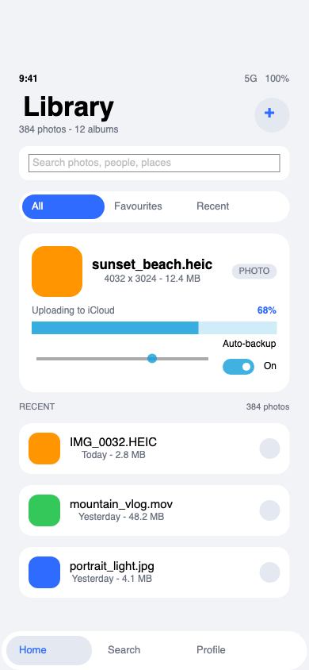

# SwimUI

**SwimUI** is [Swim](docs/swim.md) — a Swift-syntax language that compiles
**directly to C** — with a **FerroUI** native module and a **SwiftUI-shaped view
layer** on top of it: applications are written in Swift-like syntax, with
SwiftUI-like declarative views, state and modifiers, and drawn by the
[FerroUI](https://github.com/wieslawsoltes/FerroUI) cross-platform UI framework.

```swift
import SwimUI

final class CounterModel {
    let count = State(0)
}

func CounterView(_ model: CounterModel) -> View {
    VStack(spacing: 16) {
        Text("Count: \(model.count.value)").font(.largeTitle)
        Button("Add") {
            model.count.value = model.count.value + 1
        }
        .buttonStyle(.borderedProminent)
    }
    .padding(24)
}

@main
struct CounterApp {
    var body: Scene {
        WindowGroup("Counter", width: 390, height: 500) {
            CounterView(counterModel)
        }
    }

    static func main() {
        setThemeVariant("dark")
        launch(CounterApp().body)
    }
}
```

```console
$ ./scripts/build-ffi.sh      # build the FerroUI bridge (once)
$ ./scripts/run-demo.sh       # build and run the demo below
```



The demo (`examples/ui/LibraryApp.sw`, 390 × 844 points, a borderless phone-sized
window)
is interactive: the segmented control swaps the hero file, the slider moves the
upload percent, the switch toggles the backup mode, tapping a photo row selects
it, the two `+` buttons change the album and photo counts, the bottom tabs
switch and a toast reports what happened.

---

## Table of contents

- [What SwimUI is](#what-swimui-is)
- [The Swim it is built on](#the-swim-it-is-built-on)
- [How it works](#how-it-works)
- [Quick start](#quick-start)
- [The SwiftUI-shaped layer](#the-swiftui-shaped-layer)
- [The `FerroUI` native module](#the-ferroui-native-module)
- [Project layout](#project-layout)
- [Compiler changes in this fork](#compiler-changes-in-this-fork)
- [Tests](#tests)
- [Differences from SwiftUI / limitations](#differences-from-swiftui--limitations)
- [License](#license)

---

## What SwimUI is

Three projects, one stack:

| Layer | Project | What it brings |
| --- | --- | --- |
| Language | [Swim](docs/swim.md) | Swift syntax, compiled straight to C, atomic ARC, modules, a full standard library |
| UI | [FerroUI](https://github.com/wieslawsoltes/FerroUI) | A retained-mode UI framework in Rust: properties, styling, themes, layout, text, native windows |
| Binding + view layer | **SwimUI** (this repository) | `import FerroUI` in a `.sw` file, the SwiftUI-shaped layer (`import SwimUI`), and the demo |

Swim's design goal is that a `.sw` file never mentions C: the generated program
is C, but every token in a source file is Swift-style.  SwimUI keeps that rule
for FerroUI — a program calls a small, flat surface of `Int` handles, numbers,
strings, booleans and `() -> Void` closures, and never sees a C type.

```
  examples/ui/LibraryApp.sw    a program in Swift syntax (SwiftUI-shaped)
        │
  src/swimc/                   the Swim compiler: lexer, parser, types, checker,
        │                      codegen_c, cli
        │  emits
  <program>.c                  C, with `#include "swimferroui.h"` and calls of
        │                      the `swimferroui_*` shim; the compiler also adds
        │                      runtime/swimferroui.c and links the bridge
        │  links with
  runtime/swimrt*.c            the Swim runtime (ARC, values, stdlib)
  runtime/swimferroui.c        the C shim of the binding: SwimValue <-> C ABI,
        │                      closures, colours
        │  calls through
  build/libferroui_swim.dylib  the Rust bridge (ffi/): hosts the FerroUI
        │                      application, the controls and the window
        │  builds
  FerroUI (Rust)               windows, controls, themes, the compositor
```

## The Swim it is built on

The language comes from the **Swim** checkout this repository was cut from:

- repository: `/Users/steveriemannx/projects-main/Swim` (the sibling folder)
- branch: **`main`** — the direct-to-C backend is on `main`, not on a side
  branch
- commit: **`789eb03` “Direct-to-C backend, atomic ARC (weak/unowned/deinit),
  Swim rename”**, one commit ahead of `origin/main` (`b9d15de`), working tree
  clean
- compiler version: `Swim 0.2.0 (direct C backend, atomic ARC, MIT)`

The Nim backend is gone upstream: `import Nimx` is retired, the compiler emits
C11 and links `runtime/swimrt*.c`.  Upstream therefore has *no* native modules
and no GUI story; SwimUI adds both — a C-level native-module mechanism for the
`FerroUI` binding and the SwiftUI-shaped view layer.

## How it works

**The compiler knows the module.**  `import FerroUI` is a native module of the
SwimUI fork:

- `src/swimc/modules.py` accepts the name (`NATIVE_MODULES`), records it on the
  project and retires the Nim-era names (`Nimx`, `Zeta`) with an explanation;
- `src/swimc/native_ferroui.py` holds the table of the binding's functions: the
  C function, the argument labels and the kind of every argument (`int`,
  `double`, `string`, `bool`, `closure`), and the result kind;
- `src/swimc/checker.py` type-checks every call against that table — a missing
  argument, an unknown label, a wrong type or a `ferroui*` name without
  `import FerroUI` is a compile error with a `.sw` location;
- `src/swimc/codegen_c.py` emits `#include "swimferroui.h"` and a direct C call
  for every `ferroui*` function (plus the typed enum-case arguments; see
  [Compiler changes](#compiler-changes-in-this-fork));
- `src/swimc/cli.py` compiles `runtime/swimferroui.c` into the program, adds
  `ffi/include` as an include directory and links the bridge library
  (`-L build -lferroui_swim -Wl,-rpath,build`), so a program build needs no
  manual C flags.

**The C shim.**  `runtime/swimferroui.c` + `.h` is the only C code a program
compiles besides the runtime.  It turns the dynamic `SwimValue`s of generated
code into the flat C ABI of the bridge: `SwimUnboxInt`/`Double`/`Bool`, string
bytes, and closures.  A `() -> Void` closure becomes a retained `SwimValue` in a
cell; the bridge calls a trampoline with the cell's address as its `user` value
and the shim runs the closure on the UI thread.  Colours become `0xAARRGGBB`,
handles are `int64_t`.

**The Rust bridge.**  `ffi/` is a `cdylib` crate, `ferroui-swim`, that owns the
FerroUI application (`AppBuilder` + the simple theme), the visual tree and the
native window.  Its ABI (`ffi/include/ferroui_swim.h`) has 35 functions: the
application and the window, the tree (create/add/insert/remove/clear/destroy),
properties (set/get doubles, ints, strings, booleans, brushes, thicknesses,
enums), flex layout and child grow, events and timers, and snapshots.  The ABI
version is checked by the shim at start-up.

**The view layer.**  `examples/ui/SwimUI.sw` is an ordinary Swim module (not part of the
compiler) that builds a declarative tree (`VStack`, `Text`, `Button`,
`TextField`, `Toggle`, `Slider`, `ProgressView`, `List`, `ScrollView`,
`ZStack`, shapes, `Spacer`, `Divider`, `Group`, `ForEach`), lets modifiers
mutate a node, and — when a `State` changes — rebuilds the tree, walks the
mounted tree in lockstep and patches the FerroUI controls in place.  See
[docs/swiftui.md](docs/swiftui.md).

## Quick start

Requirements: **Python 3.9+**, a **C11 compiler** (clang/gcc), a **Rust**
toolchain (cargo), and a checkout of **FerroUI** next to this one (`../FerroUI`;
`FERROUI_DIR` selects another).

```console
$ ./scripts/build-ffi.sh      # build the Rust bridge into build/ (once)
$ ./scripts/run-demo.sh       # build and run examples/ui/LibraryApp.sw
```

Useful commands:

```console
$ ./scripts/run-demo.sh --snapshot examples/ui/shots/demo.png  # one frame, then quit
$ ./scripts/run-demo.sh --smoke                        # the same, for a test
$ ./scripts/run-demo.sh --no-run                       # build only
$ ./scripts/run-demo.sh --program examples/ui/CounterApp.sw  # a smaller program
$ ./bin/Swim run examples/ui/LibraryApp.sw             # after the bridge is built
```

`./bin/Swim` is the compiler launcher, exactly as in Swim: `Swim run`,
`Swim build`, `Swim check`, `Swim emit`, `Swim deps`, `Swim version`.

The first `build-ffi.sh` compiles the bridge against FerroUI.  It points cargo's
target directory at `$FERROUI_DIR/target`, so it reuses the artifacts of an
existing FerroUI build; a from-scratch FerroUI debug build is tens of GB and
takes a long time.

A program reads three environment variables at run time, which is how a test or
a documentation run drives it without a person:

| Variable | Meaning |
| --- | --- |
| `SWIMUI_IMAGE` | write a PNG of the window there (`snapshot(...)`) |
| `SWIMUI_QUIT_MS` | close the window after that many milliseconds |
| `SWIMUI_THEME_VARIANT` | `dark`, `light` or `system` (unless the program calls `setThemeVariant`) |

## The SwiftUI-shaped layer

`import SwimUI` gives the declarative API.  The shape is SwiftUI's; where the
language or the binding cannot follow, [docs/swiftui.md](docs/swiftui.md) says
exactly how it deviates.

```swift
import SwimUI

let library = LibraryModel()          // the state lives in a model...

func LibraryView(_ model: LibraryModel) -> View {   // ...and views are functions of it
    VStack(alignment: .leading, spacing: 14) {
        Text("Library").font(.largeTitle)
        HStack(spacing: 12) {
            Text("\(model.albums.value) albums").foregroundColor(.secondary)
            Spacer()
            Button("+") { model.albums.value = model.albums.value + 1 }
                .buttonStyle(.borderedProminent)
        }
        ForEach(model.rows) { row in
            HStack {
                Text(row.title)
                Spacer()
                if row.selected.value {
                    Circle().fill(Color.accent).frame(width: 26, height: 26)
                }
            }
            .padding(12)
            .background(Color.surface)
            .cornerRadius(16)
            .onTapGesture { row.selected.value = !row.selected.value }
        }
        Spacer()
    }
    .padding(22)
    .expand()
    .background(Color.background)
}

@main
struct LibraryApp {
    var body: Scene {
        WindowGroup("Library", width: 390, height: 844,
                    background: Color.background) {
            LibraryView(library)
        }
    }

    static func main() {
        setThemeVariant("dark")
        launch(LibraryApp().body)
    }
}
```

| SwiftUI | SwimUI | Notes |
| --- | --- | --- |
| `struct ContentView: View { var body: some View }` | `func ContentView(_ model:) -> View` | protocols have no associated types in Swim; views are functions |
| `@State var count = 0` | `let count = State(0)` in a model class | no property wrappers in Swim |
| `@ViewBuilder` trailing closures | the same syntax | a builder stack collects the children |
| `.frame(maxWidth: .infinity)` | `.expand()` | see [docs/swiftui.md](docs/swiftui.md) |
| `Slider(value: $x, in: 0...100)` | `Slider(value: model.x, minimum: 0.0, maximum: 100.0)` | `in` is a keyword; `$` projections do not exist |
| `.padding(.horizontal, 8)` | `.padding(.horizontal, 8)` | `Edge` is the same idea |
| `.onTapGesture { }`, `.buttonStyle(.borderedProminent)` | the same | |
| `List { ForEach(items) { } }` | the same | a scrollable column |
| `ProgressView(value: x, total: y)` | the same | |
| `Text("…").font(.title).bold()` | the same | |

Every view mounts as a FerroUI `Border` wrapper (padding, background, border,
corner radius) around one host control; stacks are FerroUI `FlexPanel`s,
`ZStack` is a `Panel`, lists and scroll views are `ScrollViewer`s, `Toggle` is a
`ToggleSwitch`, and the theme (simple theme, dark/light) draws them.

## The `FerroUI` native module

The layer is written in Swim on top of the flat module; a program can use the
module directly.  The full reference is [docs/ferroui.md](docs/ferroui.md); the
shape is:

```swift
import FerroUI

ferrouiSetThemeVariant(name: "dark")

ferrouiRun {
    let window = ferrouiWindow(width: 320, height: 240, title: "Flat",
                               background: 0x101014, onClosed: {})
    let page = ferrouiCreate(parent: window, kind: 3)       // border
    ferrouiSetThickness(handle: page, property: 2,         // padding
                        left: 16, top: 16, right: 16, bottom: 16)
    let label = ferrouiCreate(parent: page, kind: 4)        // text block
    ferrouiSetString(handle: label, property: 1, value: "Hello")
    ferrouiSetF64(handle: label, property: 7, value: 18.0)  // font size
    ferrouiAfter(ms: 900) {
        ferrouiSetString(handle: label, property: 1, value: "Hello again")
    }
}
```

## Project layout

```
bin/Swim                     the compiler launcher (from Swim)
src/swimc/                   the Swim compiler; native_ferroui.py, modules.py,
                             checker.py, codegen_c.py and cli.py carry the
                             FerroUI native module (this fork)
runtime/swimrt*.c, .h        the Swim runtime (from Swim, unmodified)
runtime/swimferroui.c, .h    the C shim of the FerroUI binding (new)
ffi/                         the Rust bridge `ferroui-swim`, a cdylib (extended)
  include/ferroui_swim.h     its C ABI, the contract of the two sides
examples/                    the language examples of Swim, and the SwimUI
                             examples in ui/
  ui/SwiftUI.sw              the SwiftUI-shaped declarative layer (new)
  ui/LibraryApp.sw           the demo in the screenshot
  ui/CounterApp.sw           the smallest layer app
  ui/shots/demo.png          the demo's snapshot
scripts/build-ffi.sh         build the bridge into build/
scripts/run-demo.sh          build and run a program of the binding
tests/binding/               the binding's Swim programs (native + layer)
tests/binding_test.py        the end-to-end tests of the binding
docs/swim.md                 the Swim readme (kept from the language project)
docs/ferroui.md              the binding reference
docs/swiftui.md              the SwiftUI-shaped layer reference
docs/language.md             the Swim language tour
docs/internals.md            the Swim compiler internals, with the native module
                             recipe of this fork
```

## Compiler changes in this fork

The binding needed four fixes to the C compiler; each has a regression test in
`tests/cases/`:

| Fix | Symptom before | Test |
| --- | --- | --- |
| A global read inside a method or a closure in a method | resolved to `self.<name>` and read `nil` | `tests/cases/42_global_in_method.sw` |
| An enum-case argument (`.leading`) to a free function | emitted untyped; the dynamic dispatcher could not bind the call and reported `unknown function` | `tests/cases/43_enum_case_argument.sw` |
| The return-type walk over a statement list | crashed on lists of non-node values (empty closures, several closures per body) | exercised by every UI program |
| The FerroUI native module itself | none — upstream has no native modules in the C backend | `tests/binding_test.py` |

The `Swim test` suite passes unchanged (73 cases, including the two new ones).

## Tests

```console
$ make test               # the Swim compiler and runtime suite (73 tests)
$ make test-binding       # the end-to-end test of the FerroUI binding
$ make check              # type-check the examples, the tests and examples/ui/
$ make demo               # build and run the demo
$ make ffi                # build the Rust bridge
```

`tests/binding_test.py` checks the layers without a person at the screen:

- **compiler**: `import FerroUI` resolves, the emitted C includes the shim,
  calls `swimferroui_*`, and a call without the import or the retired
  `import Nimx` is an error;
- **programs**: every program under `examples/ui/` and `tests/binding/` builds with the
  shim compiled in and the bridge linked;
- **native module** (`tests/binding/NativeTest.sw`): every control kind, the
  setters and getters, the tree operations, events raised as a pointer would
  raise them, timers, and two snapshots that differ;
- **layer** (`tests/binding/SwimUITest.sw`): state changes re-render and patch
  the mounted controls (the text read back from the controls proves it), a click
  raised as a pointer would runs the action, and the snapshots before and after
  differ;
- **demo**: it runs, writes a 390 × 844 PNG with content, quits on its own and
  reports no failed bridge call.

## Differences from SwiftUI / limitations

The short version (details in [docs/swiftui.md](docs/swiftui.md)):

- no property wrappers: state is `State<T>` objects in a model class, written as
  `model.count.value = ...`;
- views are functions returning `View`, not structs conforming to a protocol
  (Swim protocols have no associated types, so `var body: some View` cannot be
  expressed);
- no result builders: the trailing-closure syntax is the same, but a builder
  stack collects the children behind the scenes;
- `.expand()` stands in for `.frame(maxWidth: .infinity)`, and `in:` is a
  language keyword, so `Slider` takes `minimum:`/`maximum:`;
- one window per program; a curated set of controls (no grid, navigation,
  animation, gestures, data binding or XAML);
- avoid two methods of the same name where one has defaulted parameters: the
  runtime binds the first method whose labels fit, so `.frame(height:)` and
  `.frame(width:height:)` cannot coexist as overloads (this is why `frame`,
  `ProgressView` and `padding` are single functions with defaults).

## License

MIT (see [LICENSE](LICENSE)), the same as Swim and FerroUI.  SwimUI uses no code
from the official Swift repository or the Swift standard library.
