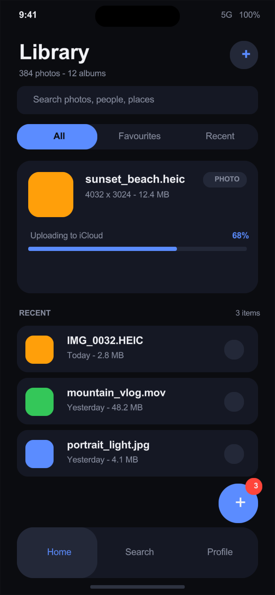

# Swim + nimx: phone-sized GUI demo

A complete GUI application written in **Swim** (Swift syntax, Nim backend) and
drawn with **[nimx](https://github.com/yglukhov/nimx)**.  The canvas is
**390 × 844 points** — an iPhone-sized screen, rendered 2× on Retina displays
(the screenshot below is 780 × 1688 px).



```
PhoneDemo.sw     the demo app (window, layout, widgets, callbacks)
NimxUI.sw        Swift-style `View` wrapper over the Nimx bridge
run.sh           build & run (atomic ARC by default)
fetch-deps.sh    fetch nimx and the Nim packages it needs into .deps/
```

## Quick start

```console
$ ./fetch-deps.sh                                  # clones nimx deps into .deps/
$ NIMX_PATH=~/projects-main/nimx ./run.sh          # build and show the window
```

`run.sh` needs a nimx checkout; point `NIMX_PATH` at it (default
`~/projects-main/nimx`).  macOS is the primary target (the window is made
borderless so it looks like a phone — press **Esc** to close it); Linux/Windows
work through nimx's SDL2 backend as well.

Useful flags:

```console
$ ./run.sh --bundle                        # build a .app and launch it
$ ./run.sh --snapshot shots/phone.png      # render one frame to a PNG, then quit
$ ./run.sh --snapshot --bundle shots/phone.png
$ SWIM_MM=arc ./run.sh                     # opt out of atomic ARC
$ ./run.sh --no-run                        # only build
```

## What you need

- a [nimx](https://github.com/yglukhov/nimx) checkout (`NIMX_PATH`)
- SDL2 (e.g. `brew install sdl2`); `run.sh` finds it in `/opt/homebrew/lib`,
  `/usr/local/lib`, or `/usr/lib*` (`SDL2_LIBDIR` overrides)
- Nim (Swim finds it automatically)
- the Nim packages `fetch-deps.sh` clones into `.deps/pkgs`

## Memory management: atomic ARC, like Swift

Swift uses **atomically reference-counted ARC**: every strong reference
update is atomic, so objects can be shared between threads.  Nim's equivalent
is `--mm:atomicArc`; `run.sh` builds with it by default:

```console
$ ./run.sh          # → Swim build … --mm atomicArc
```

The demo class `View` in `NimxUI.sw` is a plain Swim class, so it is
reference-counted by the same ARC machinery as any Swift object.  A handle
inside the class keeps the underlying nimx view alive as long as the window
hierarchy references it — no `retain`/`release` and no tracing GC.

For programs that never share objects between threads the cheaper
`--mm:arc` (Swim's default) is a drop-in replacement:

```console
$ SWIM_MM=arc ./run.sh
```

## How it works

Swim sources may only contain Swift syntax, so a Nim library is never imported
inside a `.sw` file.  Instead `import Nimx` is a **native module**: the Swim
compiler emits `import swimnimx` into the generated Nim, and
`runtime/swimnimx.nim` wraps nimx behind a small, flat API made of `Int`
handles, integers, booleans, strings and `proc()` callbacks:

```swift
let screen = nimxScreen(width: 390, height: 844, title: "…", background: 0x0B0C10)
let header = screen.label(x: 24, y: 54, width: 260, height: 42,
                          text: "Library", size: 30, bold: true)
let plus = screen.button(x: 326, y: 58, width: 40, height: 40, title: "+",
                         fill: 0x232838, titleColor: 0x5B8CFF, radius: 20) {
    showToast("Album created")
}
runApp()
```

`NimxUI.sw` turns those handles into the `View` class the demo uses, which
keeps the app code ordinary Swift-looking method calls:

```swift
let row = screen.panel(x: 24, y: y, width: 342, height: 66,
                       color: surface, radius: 16)
row.label(x: 68, y: 12, text: "IMG_0032.HEIC", size: 15, bold: true)
row.onTap {
    toggleSelection(index, dot: dot, innerDot: innerDot)
}
```

The Nim side of the bridge lives in
[`../runtime/swimnimx.nim`](../runtime/swimnimx.nim); the Swim-facing function
table is `NIMX_FUNCS` in
[`../src/swimc/codegen.py`](../src/swimc/codegen.py).

## The demo

| Area | What it does |
| --- | --- |
| Segmented control | All / Favourites / Recent — swaps the hero file, upload progress and header |
| Recent rows | tap a row to toggle its selection dot; the counter and toast update |
| Floating `+` button | adds a photo, bumps the badge and shows a toast |
| Header `+` button | creates an album and updates the subtitle |
| Bottom tab bar | Home / Search / Profile — highlight and subtitle change |

Everything is built from three primitives: rounded panels, labels, and
tap targets (plus a progress bar).  There are no image assets and no font files
to ship: the bridge uses the system Arial TTF on macOS and DejaVu/Liberation on
Linux (or a TTF dropped next to the executable).

## Rendering a screenshot

`--snapshot <png>` passes `-d:swimNimxSnapshotPath=<png>` to the Nim compiler;
the bridge then draws one full frame at startup, reads the OpenGL back buffer
and writes a PNG before exiting.  This is what produced `shots/phone.png`, and
it makes the UI testable in CI without a screen-recording permission.
